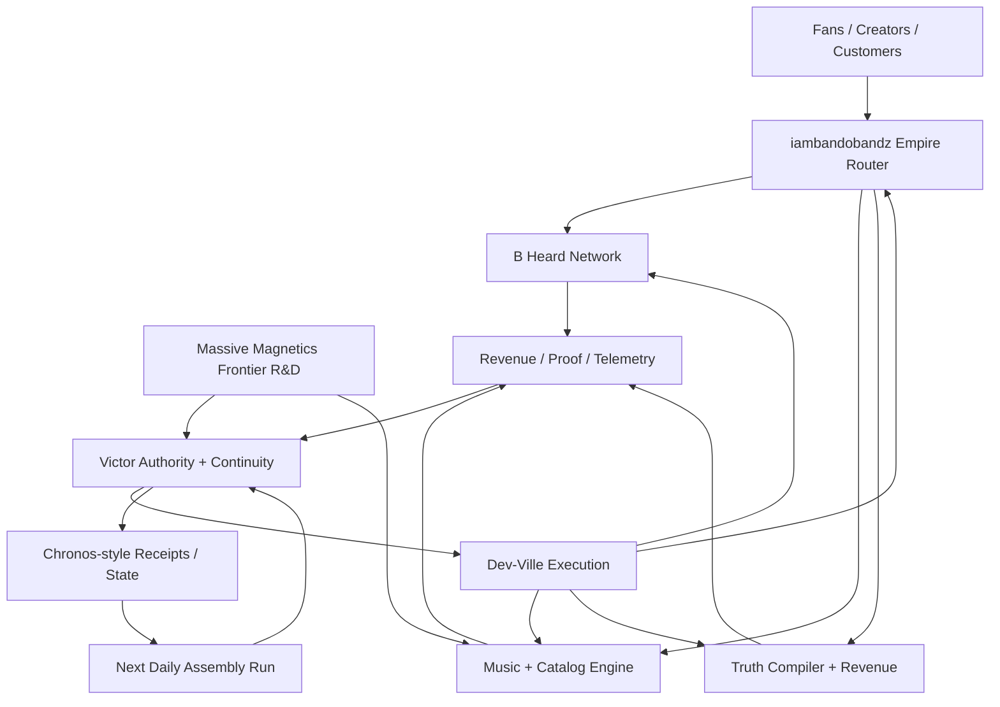

# Empire Status

**Generated:** 2026-10-13T19:52:16.709614+00:00  
**Owner:** `MASSIVEMAGNETICS`  
**Mode:** `observe-plan-assemble-local`

## Bippity Boppity Boop Loop

`SCAN → CLASSIFY → ASSEMBLE → VERIFY → RECEIPT → PRIORITIZE → NEXT RUN`

The daily run observes the lattice, runs Victor's local assembler, writes state, and ranks the shortest path to MERGED / SHIPPED / MONETIZED. Cross-repository writes stay disabled unless explicitly authorized.

## Scoreboard

| Metric | Value |
|---|---:|
| Visible repositories | 304 |
| Canonical repositories visible | 16 |
| Active in last 14 days | 17 |
| Archived | 0 |
| Private visible | 0 |
| Open PRs discovered | 63 |
| Estimated open issues | 6 |

## Empire Skin / Pillars

| Pillar | Repos | Canonical | Active ≤14d | Open PRs | ~Issues |
|---|---:|---:|---:|---:|---:|
| iambandobandz / Empire Router | 11 | 1 | 3 | 3 | 3 |
| Victor Authority + Continuity | 90 | 5 | 6 | 32 | 2 |
| Dev-Ville Execution Layer | 6 | 3 | 1 | 3 | 1 |
| Music + Catalog Engine | 25 | 3 | 4 | 3 | 0 |
| B Heard Network | 0 | 0 | 0 | 0 | 0 |
| Truth Compiler + Revenue | 5 | 1 | 0 | 0 | 0 |
| Massive Magnetics Frontier R&D | 25 | 3 | 0 | 5 | 0 |
| Supporting Lattice | 142 | 0 | 3 | 17 | 0 |

## Highest-Attention Repositories

The attention score is a routing heuristic, not a quality score. It combines strategic pillar weight, recency, canonical status, and unresolved work pressure.

| Score | Repository | Pillar | Age | PRs | ~Issues |
|---:|---|---|---:|---:|---:|
| 75 | [MASSIVEMAGNETICS/MASSIVEMAGNETICS.github.io](https://github.com/MASSIVEMAGNETICS/MASSIVEMAGNETICS.github.io) | iambandobandz / Empire Router | 0d | 2 | 3 |
| 69 | [MASSIVEMAGNETICS/dev-ville](https://github.com/MASSIVEMAGNETICS/dev-ville) | Dev-Ville Execution Layer | 1d | 2 | 1 |
| 64 | [MASSIVEMAGNETICS/omni](https://github.com/MASSIVEMAGNETICS/omni) | Victor Authority + Continuity | 5d | 2 | 0 |
| 62 | [MASSIVEMAGNETICS/victor-sovereign-puzzle-assembler](https://github.com/MASSIVEMAGNETICS/victor-sovereign-puzzle-assembler) | Victor Authority + Continuity | 0d | 1 | 0 |
| 61 | [MASSIVEMAGNETICS/victor_empire](https://github.com/MASSIVEMAGNETICS/victor_empire) | Victor Authority + Continuity | 28d | 4 | 1 |
| 57 | [MASSIVEMAGNETICS/victorOS](https://github.com/MASSIVEMAGNETICS/victorOS) | Victor Authority + Continuity | 12d | 1 | 0 |
| 52 | [MASSIVEMAGNETICS/VICTOR-SSI](https://github.com/MASSIVEMAGNETICS/VICTOR-SSI) | Victor Authority + Continuity | 50d | 11 | 0 |
| 50 | [MASSIVEMAGNETICS/starpower-core](https://github.com/MASSIVEMAGNETICS/starpower-core) | Music + Catalog Engine | 0d | 1 | 0 |
| 47 | [MASSIVEMAGNETICS/victor_llm](https://github.com/MASSIVEMAGNETICS/victor_llm) | Victor Authority + Continuity | 96d | 5 | 0 |
| 40 | [MASSIVEMAGNETICS/shared-intelligence](https://github.com/MASSIVEMAGNETICS/shared-intelligence) | Supporting Lattice | 1d | 1 | 0 |
| 40 | [MASSIVEMAGNETICS/caddy-vic](https://github.com/MASSIVEMAGNETICS/caddy-vic) | iambandobandz / Empire Router | 7d | 0 | 0 |
| 40 | [MASSIVEMAGNETICS/claude-mem-vic](https://github.com/MASSIVEMAGNETICS/claude-mem-vic) | Victor Authority + Continuity | 7d | 0 | 0 |
| 40 | [MASSIVEMAGNETICS/e2e-vic](https://github.com/MASSIVEMAGNETICS/e2e-vic) | iambandobandz / Empire Router | 7d | 0 | 0 |
| 40 | [MASSIVEMAGNETICS/OpenMontage-vic](https://github.com/MASSIVEMAGNETICS/OpenMontage-vic) | Victor Authority + Continuity | 10d | 0 | 0 |
| 40 | [MASSIVEMAGNETICS/victor](https://github.com/MASSIVEMAGNETICS/victor) | Victor Authority + Continuity | 12d | 0 | 0 |

## Next Assembly Queue

1. **P0 — [Review draft PR #35: Integrate delivery role runtime with recorded QA and release packaging](https://github.com/MASSIVEMAGNETICS/dev-ville/pull/35)** — GitHub marks the pull request as draft.
2. **P0 — [Review draft PR #34: Integrate ten-role ticket runtime with recorded QA and invalidating handoffs](https://github.com/MASSIVEMAGNETICS/dev-ville/pull/34)** — GitHub marks the pull request as draft.
3. **P0 — [Review draft PR #3: ci(empire): daily read-only BANDO_DRIVER maintenance pass](https://github.com/MASSIVEMAGNETICS/shared-intelligence/pull/3)** — GitHub marks the pull request as draft.
4. **P0 — [Review draft PR #2: Close AI Ear placeholder with deterministic local acoustic evidence](https://github.com/MASSIVEMAGNETICS/omni/pull/2)** — GitHub marks the pull request as draft.
5. **P0 — [Review draft PR #8: Add bounded Empire Autonomy Kernel and B Heard economic sandbox](https://github.com/MASSIVEMAGNETICS/victor_empire/pull/8)** — GitHub marks the pull request as draft.
6. **P1 — [Triage stale canonical repo: victor-whole](https://github.com/MASSIVEMAGNETICS/victor-whole)** — Canonical repo has not been pushed in 107 days.
7. **P1 — [Triage stale canonical repo: Victor-Synthetic-Orchestrator](https://github.com/MASSIVEMAGNETICS/Victor-Synthetic-Orchestrator)** — Canonical repo has not been pushed in 53 days.
8. **P1 — [Triage stale canonical repo: repo-brain](https://github.com/MASSIVEMAGNETICS/repo-brain)** — Canonical repo has not been pushed in 194 days.
9. **P1 — [Triage stale canonical repo: victor-os-autodeploy](https://github.com/MASSIVEMAGNETICS/victor-os-autodeploy)** — Canonical repo has not been pushed in 143 days.
10. **P1 — Resolve unseen canonical repo: MASSIVEMAGNETICS/suno-killer** — Manifest expects this repository, but authenticated owner/private inventory coverage is incomplete. Verify repository visibility, existence, and canonical role before changing the manifest or attempting recovery.
11. **P1 — [Triage stale canonical repo: victor-suno-godcore](https://github.com/MASSIVEMAGNETICS/victor-suno-godcore)** — Canonical repo has not been pushed in 57 days.
12. **P1 — [Triage stale canonical repo: massive_starpower](https://github.com/MASSIVEMAGNETICS/massive_starpower)** — Canonical repo has not been pushed in 120 days.

## Coverage Warnings

The run completed with API limitations. Public data and any successfully visible private data were still processed.

- `GitHub API 403 for /user/repos: Resource not accessible by integration`

## Architecture

---
Generated by `empire_autopilot_guarded.py`. The machine-readable receipt is `state/empire.json`.
