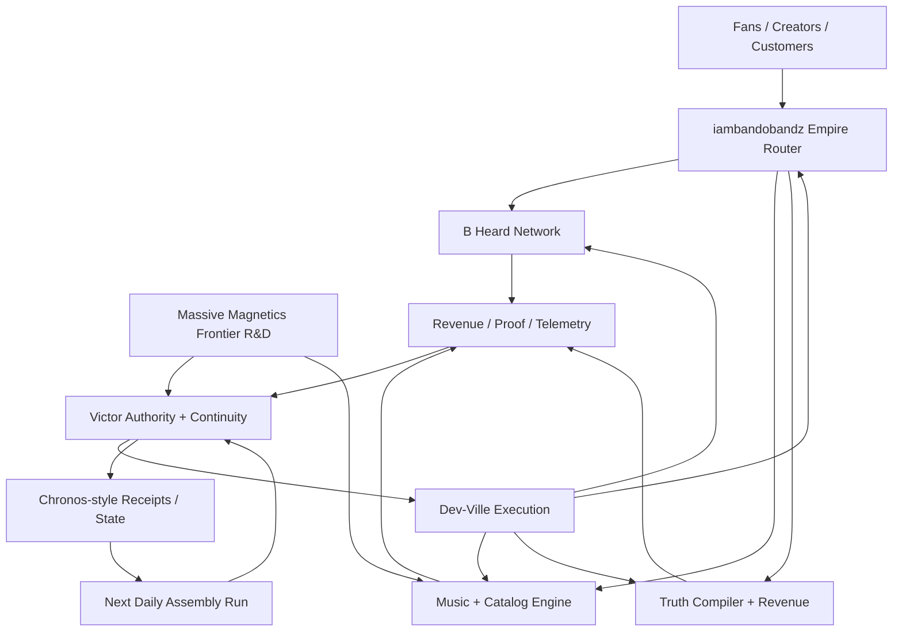

# Empire Status

**Generated:** 2026-11-14T18:44:18.948308+00:00  
**Owner:** `MASSIVEMAGNETICS`  
**Mode:** `observe-plan-assemble-local`

## Bippity Boppity Boop Loop

`SCAN → CLASSIFY → ASSEMBLE → VERIFY → RECEIPT → PRIORITIZE → NEXT RUN`

The daily run observes the lattice, runs Victor's local assembler, writes state, and ranks the shortest path to MERGED / SHIPPED / MONETIZED. Cross-repository writes stay disabled unless explicitly authorized.

## Scoreboard

| Metric | Value |
|---|---:|
| Visible repositories | 304 |
| Canonical repositories visible | 16 |
| Active in last 14 days | 8 |
| Archived | 0 |
| Private visible | 0 |
| Open PRs discovered | 67 |
| Estimated open issues | 8 |

## Empire Skin / Pillars

| Pillar | Repos | Canonical | Active ≤14d | Open PRs | ~Issues |
|---|---:|---:|---:|---:|---:|
| iambandobandz / Empire Router | 11 | 1 | 1 | 6 | 3 |
| Victor Authority + Continuity | 90 | 5 | 3 | 31 | 3 |
| Dev-Ville Execution Layer | 6 | 3 | 1 | 6 | 2 |
| Music + Catalog Engine | 25 | 3 | 3 | 2 | 0 |
| B Heard Network | 0 | 0 | 0 | 0 | 0 |
| Truth Compiler + Revenue | 5 | 1 | 0 | 0 | 0 |
| Massive Magnetics Frontier R&D | 25 | 3 | 0 | 5 | 0 |
| Supporting Lattice | 142 | 0 | 0 | 17 | 0 |

## Highest-Attention Repositories

The attention score is a routing heuristic, not a quality score. It combines strategic pillar weight, recency, canonical status, and unresolved work pressure.

| Score | Repository | Pillar | Age | PRs | ~Issues |
|---:|---|---|---:|---:|---:|
| 86 | [MASSIVEMAGNETICS/MASSIVEMAGNETICS.github.io](https://github.com/MASSIVEMAGNETICS/MASSIVEMAGNETICS.github.io) | iambandobandz / Empire Router | 0d | 5 | 3 |
| 82 | [MASSIVEMAGNETICS/dev-ville](https://github.com/MASSIVEMAGNETICS/dev-ville) | Dev-Ville Execution Layer | 3d | 5 | 2 |
| 71 | [MASSIVEMAGNETICS/victorOS](https://github.com/MASSIVEMAGNETICS/victorOS) | Victor Authority + Continuity | 0d | 2 | 1 |
| 70 | [MASSIVEMAGNETICS/VICTOR-SSI](https://github.com/MASSIVEMAGNETICS/VICTOR-SSI) | Victor Authority + Continuity | 1d | 9 | 0 |
| 62 | [MASSIVEMAGNETICS/victor-sovereign-puzzle-assembler](https://github.com/MASSIVEMAGNETICS/victor-sovereign-puzzle-assembler) | Victor Authority + Continuity | 0d | 1 | 0 |
| 54 | [MASSIVEMAGNETICS/victor_empire](https://github.com/MASSIVEMAGNETICS/victor_empire) | Victor Authority + Continuity | 60d | 4 | 1 |
| 51 | [MASSIVEMAGNETICS/omni](https://github.com/MASSIVEMAGNETICS/omni) | Victor Authority + Continuity | 37d | 2 | 0 |
| 50 | [MASSIVEMAGNETICS/SUNOKILLER](https://github.com/MASSIVEMAGNETICS/SUNOKILLER) | Music + Catalog Engine | 0d | 1 | 0 |
| 47 | [MASSIVEMAGNETICS/victor_llm](https://github.com/MASSIVEMAGNETICS/victor_llm) | Victor Authority + Continuity | 128d | 5 | 0 |
| 43 | [MASSIVEMAGNETICS/starpower-core](https://github.com/MASSIVEMAGNETICS/starpower-core) | Music + Catalog Engine | 0d | 0 | 0 |
| 43 | [MASSIVEMAGNETICS/united-maSTERS](https://github.com/MASSIVEMAGNETICS/united-maSTERS) | Music + Catalog Engine | 1d | 0 | 0 |
| 37 | [MASSIVEMAGNETICS/Victor-Synthetic-Orchestrator](https://github.com/MASSIVEMAGNETICS/Victor-Synthetic-Orchestrator) | Victor Authority + Continuity | 85d | 0 | 0 |
| 37 | [MASSIVEMAGNETICS/the-ai-ear](https://github.com/MASSIVEMAGNETICS/the-ai-ear) | Music + Catalog Engine | 183d | 1 | 0 |
| 37 | [MASSIVEMAGNETICS/NexusForge-2.0-](https://github.com/MASSIVEMAGNETICS/NexusForge-2.0-) | Massive Magnetics Frontier R&D | 211d | 3 | 0 |
| 36 | [MASSIVEMAGNETICS/VICCTORIAN](https://github.com/MASSIVEMAGNETICS/VICCTORIAN) | Victor Authority + Continuity | 211d | 2 | 0 |

## Next Assembly Queue

1. **P0 — [Review draft PR #22: Issue #19: transactional outbox for cognitive scheduler](https://github.com/MASSIVEMAGNETICS/victorOS/pull/22)** — GitHub marks the pull request as draft.
2. **P0 — [Review draft PR #5: docs: add release-evidence gate for SUNOKILLER claims](https://github.com/MASSIVEMAGNETICS/SUNOKILLER/pull/5)** — GitHub marks the pull request as draft.
3. **P0 — [Review merge candidate PR #12: Update python-dotenv requirement from <2.0.0,>=1.0.0 to >=1.2.2,<2.0.0 in /gateway](https://github.com/MASSIVEMAGNETICS/VICTOR-SSI/pull/12)** — No explicit draft/donor/review-only blocker was found. This is a review candidate only; merge still requires independent verification and approval.
4. **P0 — [Review draft PR #38: test/security: harden VSG1 decoder bounds and malformed-frame handling](https://github.com/MASSIVEMAGNETICS/dev-ville/pull/38)** — GitHub marks the pull request as draft.
5. **P0 — [Review draft PR #41: fix(chronos): fail closed when JSONL persistence is uncertain](https://github.com/MASSIVEMAGNETICS/dev-ville/pull/41)** — GitHub marks the pull request as draft.
6. **P1 — [Triage stale canonical repo: victor-whole](https://github.com/MASSIVEMAGNETICS/victor-whole)** — Canonical repo has not been pushed in 139 days.
7. **P1 — [Triage stale canonical repo: Victor-Synthetic-Orchestrator](https://github.com/MASSIVEMAGNETICS/Victor-Synthetic-Orchestrator)** — Canonical repo has not been pushed in 85 days.
8. **P1 — [Triage stale canonical repo: omni](https://github.com/MASSIVEMAGNETICS/omni)** — Canonical repo has not been pushed in 37 days.
9. **P1 — [Triage stale canonical repo: repo-brain](https://github.com/MASSIVEMAGNETICS/repo-brain)** — Canonical repo has not been pushed in 226 days.
10. **P1 — [Triage stale canonical repo: victor-os-autodeploy](https://github.com/MASSIVEMAGNETICS/victor-os-autodeploy)** — Canonical repo has not been pushed in 175 days.
11. **P1 — Resolve unseen canonical repo: MASSIVEMAGNETICS/suno-killer** — Manifest expects this repository, but authenticated owner/private inventory coverage is incomplete. Verify repository visibility, existence, and canonical role before changing the manifest or attempting recovery.
12. **P1 — [Triage stale canonical repo: victor-suno-godcore](https://github.com/MASSIVEMAGNETICS/victor-suno-godcore)** — Canonical repo has not been pushed in 89 days.

## Coverage Warnings

The run completed with API limitations. Public data and any successfully visible private data were still processed.

- `GitHub API 403 for /user/repos: Resource not accessible by integration`

## Architecture

---
Generated by `empire_autopilot_guarded.py`. The machine-readable receipt is `state/empire.json`.
