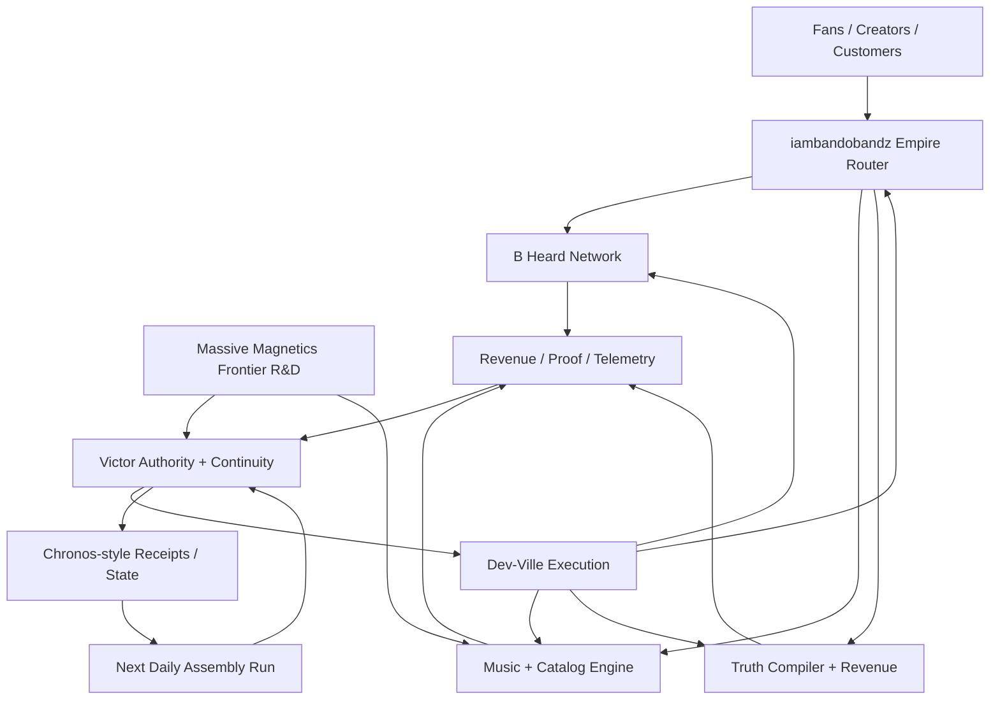

# Empire Status

**Generated:** 2026-11-07T18:02:53.372777+00:00  
**Owner:** `MASSIVEMAGNETICS`  
**Mode:** `observe-plan-assemble-local`

## Bippity Boppity Boop Loop

`SCAN → CLASSIFY → ASSEMBLE → VERIFY → RECEIPT → PRIORITIZE → NEXT RUN`

The daily run observes the lattice, runs Victor's local assembler, writes state, and ranks the shortest path to MERGED / SHIPPED / MONETIZED. Cross-repository writes stay disabled unless explicitly authorized.

## Scoreboard

| Metric | Value |
|---|---:|
| Visible repositories | 304 |
| Canonical repositories visible | 16 |
| Active in last 14 days | 6 |
| Archived | 0 |
| Private visible | 0 |
| Open PRs discovered | 71 |
| Estimated open issues | 8 |

## Empire Skin / Pillars

| Pillar | Repos | Canonical | Active ≤14d | Open PRs | ~Issues |
|---|---:|---:|---:|---:|---:|
| iambandobandz / Empire Router | 11 | 1 | 1 | 6 | 3 |
| Victor Authority + Continuity | 90 | 5 | 2 | 33 | 3 |
| Dev-Ville Execution Layer | 6 | 3 | 1 | 7 | 2 |
| Music + Catalog Engine | 25 | 3 | 1 | 3 | 0 |
| B Heard Network | 0 | 0 | 0 | 0 | 0 |
| Truth Compiler + Revenue | 5 | 1 | 0 | 0 | 0 |
| Massive Magnetics Frontier R&D | 25 | 3 | 0 | 5 | 0 |
| Supporting Lattice | 142 | 0 | 1 | 17 | 0 |

## Highest-Attention Repositories

The attention score is a routing heuristic, not a quality score. It combines strategic pillar weight, recency, canonical status, and unresolved work pressure.

| Score | Repository | Pillar | Age | PRs | ~Issues |
|---:|---|---|---:|---:|---:|
| 86 | [MASSIVEMAGNETICS/MASSIVEMAGNETICS.github.io](https://github.com/MASSIVEMAGNETICS/MASSIVEMAGNETICS.github.io) | iambandobandz / Empire Router | 0d | 5 | 3 |
| 82 | [MASSIVEMAGNETICS/dev-ville](https://github.com/MASSIVEMAGNETICS/dev-ville) | Dev-Ville Execution Layer | 2d | 6 | 2 |
| 71 | [MASSIVEMAGNETICS/victorOS](https://github.com/MASSIVEMAGNETICS/victorOS) | Victor Authority + Continuity | 2d | 2 | 1 |
| 62 | [MASSIVEMAGNETICS/victor-sovereign-puzzle-assembler](https://github.com/MASSIVEMAGNETICS/victor-sovereign-puzzle-assembler) | Victor Authority + Continuity | 0d | 1 | 0 |
| 58 | [MASSIVEMAGNETICS/omni](https://github.com/MASSIVEMAGNETICS/omni) | Victor Authority + Continuity | 30d | 2 | 0 |
| 54 | [MASSIVEMAGNETICS/victor_empire](https://github.com/MASSIVEMAGNETICS/victor_empire) | Victor Authority + Continuity | 53d | 4 | 1 |
| 52 | [MASSIVEMAGNETICS/VICTOR-SSI](https://github.com/MASSIVEMAGNETICS/VICTOR-SSI) | Victor Authority + Continuity | 75d | 11 | 0 |
| 50 | [MASSIVEMAGNETICS/starpower-core](https://github.com/MASSIVEMAGNETICS/starpower-core) | Music + Catalog Engine | 0d | 1 | 0 |
| 47 | [MASSIVEMAGNETICS/victor_llm](https://github.com/MASSIVEMAGNETICS/victor_llm) | Victor Authority + Continuity | 121d | 5 | 0 |
| 37 | [MASSIVEMAGNETICS/Victor-Synthetic-Orchestrator](https://github.com/MASSIVEMAGNETICS/Victor-Synthetic-Orchestrator) | Victor Authority + Continuity | 78d | 0 | 0 |
| 37 | [MASSIVEMAGNETICS/the-ai-ear](https://github.com/MASSIVEMAGNETICS/the-ai-ear) | Music + Catalog Engine | 176d | 1 | 0 |
| 37 | [MASSIVEMAGNETICS/NexusForge-2.0-](https://github.com/MASSIVEMAGNETICS/NexusForge-2.0-) | Massive Magnetics Frontier R&D | 204d | 3 | 0 |
| 36 | [MASSIVEMAGNETICS/VICCTORIAN](https://github.com/MASSIVEMAGNETICS/VICCTORIAN) | Victor Authority + Continuity | 204d | 2 | 0 |
| 35 | [MASSIVEMAGNETICS/shared-intelligence](https://github.com/MASSIVEMAGNETICS/shared-intelligence) | Supporting Lattice | 13d | 1 | 0 |
| 35 | [MASSIVEMAGNETICS/victor-suno-godcore](https://github.com/MASSIVEMAGNETICS/victor-suno-godcore) | Music + Catalog Engine | 82d | 0 | 0 |

## Next Assembly Queue

1. **P0 — [Review draft PR #22: Issue #19: transactional outbox for cognitive scheduler](https://github.com/MASSIVEMAGNETICS/victorOS/pull/22)** — GitHub marks the pull request as draft.
2. **P0 — [Review draft PR #41: fix(chronos): fail closed when JSONL persistence is uncertain](https://github.com/MASSIVEMAGNETICS/dev-ville/pull/41)** — GitHub marks the pull request as draft.
3. **P0 — [Review draft PR #57: feat(bheard): signed Stripe-to-D1 order intake candidate (independent backend)](https://github.com/MASSIVEMAGNETICS/MASSIVEMAGNETICS.github.io/pull/57)** — GitHub marks the pull request as draft.
4. **P0 — [Review draft PR #39: bench(vsg1): measure lossless Chronos event adapter against JSON/zlib](https://github.com/MASSIVEMAGNETICS/dev-ville/pull/39)** — GitHub marks the pull request as draft.
5. **P0 — [Review merge candidate PR #36: feat: VSG1 offline structural representation benchmark](https://github.com/MASSIVEMAGNETICS/dev-ville/pull/36)** — No explicit draft/donor/review-only blocker was found. This is a review candidate only; merge still requires independent verification and approval.
6. **P1 — [Triage stale canonical repo: victor-whole](https://github.com/MASSIVEMAGNETICS/victor-whole)** — Canonical repo has not been pushed in 132 days.
7. **P1 — [Triage stale canonical repo: Victor-Synthetic-Orchestrator](https://github.com/MASSIVEMAGNETICS/Victor-Synthetic-Orchestrator)** — Canonical repo has not been pushed in 78 days.
8. **P1 — [Triage stale canonical repo: repo-brain](https://github.com/MASSIVEMAGNETICS/repo-brain)** — Canonical repo has not been pushed in 218 days.
9. **P1 — [Triage stale canonical repo: victor-os-autodeploy](https://github.com/MASSIVEMAGNETICS/victor-os-autodeploy)** — Canonical repo has not been pushed in 168 days.
10. **P1 — Resolve unseen canonical repo: MASSIVEMAGNETICS/suno-killer** — Manifest expects this repository, but authenticated owner/private inventory coverage is incomplete. Verify repository visibility, existence, and canonical role before changing the manifest or attempting recovery.
11. **P1 — [Triage stale canonical repo: victor-suno-godcore](https://github.com/MASSIVEMAGNETICS/victor-suno-godcore)** — Canonical repo has not been pushed in 82 days.
12. **P1 — [Triage stale canonical repo: massive_starpower](https://github.com/MASSIVEMAGNETICS/massive_starpower)** — Canonical repo has not been pushed in 144 days.

## Coverage Warnings

The run completed with API limitations. Public data and any successfully visible private data were still processed.

- `GitHub API 403 for /user/repos: Resource not accessible by integration`

## Architecture

---
Generated by `empire_autopilot_guarded.py`. The machine-readable receipt is `state/empire.json`.
